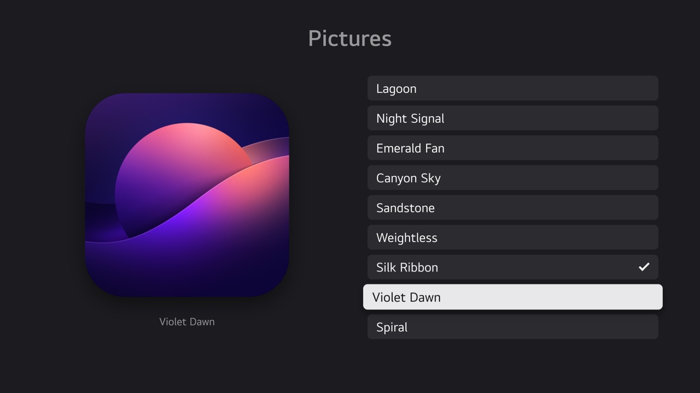

# Sei

[](https://github.com/glexe/sei/actions/workflows/check.yml)

**Your TV, without the noise.**


An ad-free home screen for rooted LG webOS TVs.

| | |
| --- | --- |
|  |  |

## Features

- Every app on the TV in one grid, with a dock row. Hold OK to move or delete an app.
- HDMI inputs show the logo of the connected device.
- Files: browse USB storage, play video in a built-in player with resume, watched marks and track selection.
- Wallpapers: photos, colors and gradients. Weather, date and time.
- 26 languages, following the TV by default.
- No background processes. No ads.

## Requirements

- A rooted TV with [Homebrew Channel](https://github.com/webosbrew/webos-homebrew-channel) and its SSH server on:
  `ssh root@<TV_IP>` has to work.
- webOS 25 or newer. Tested on one TV, an LG OLED C3 with webOS 11.2 (platform version).

Use at your own risk. Firmware updates can remove root, so keep automatic updates off; if LG Home comes back after one,
install Sei again.

## Install

From macOS or Linux:

```bash
curl -L https://github.com/glexe/sei/releases/latest/download/sei.tar.gz | tar -xz
sh sei/install.sh <TV_IP>
```

Reboot the TV when it asks, and set **Power On Screen** to **Home** in the TV settings. To update, run it again.

To remove: `sh sei/install.sh <TV_IP> remove`, then reboot. LG Home returns. A small hidden package, Sei service, stays
behind: uninstalling any app makes webOS erase the local data of all of them.

## Development

```bash
npm install
npm run dev               # browser preview with mock data, http://localhost:5173
npm run check             # types, React Compiler coverage, tests, lint, format

export TV_HOST=<TV_IP>
npm run deploy            # build and install the home screen
npm run install:service   # after service changes; needs npm install -g @webos-tools/cli
npm run release           # dist/sei.tar.gz, what the installer downloads
```

The layout is a fixed 1920×1080. In the browser, use the DevTools device toolbar at that size with **Fit to window**.

Code rules: [AGENTS.md](AGENTS.md).

## How it works

The app installs as `com.webos.app.home` version 99 in `/media/system/apps`, the directory LG uses for system app
updates. The app manager runs the highest version of an id, so Sei becomes Home: on boot, power-on, the Home key and
when an app closes. Nothing is patched.

A small Node service (`service/`, root) does what a web app can't: list, launch and uninstall apps, cache their icons
and read USB storage. It answers only Sei and starts on demand. Log: `/tmp/sei-service.log`.

The player is a `<video>` element with LG's own USB media options, so the system decodes MKV and HEVC in hardware.

## Remote

| Key | Action |
| --- | --- |
| Arrows | Move focus |
| OK | Open |
| Hold OK | Move or Delete |
| Back | Up one level, or to the top row |

Home is handled by the system and can't close Files or Settings while Sei is in front. Use Back.

## Notes

- LG Channels is kept out of memory by disabling its preload in `/var/preferences/webos-preload-manager-conf.json`
  (`"com.webos.app.lgchannels": false`), applied with `systemctl restart preload-manager.service`.
- `npm run wallpapers -- <folder>` rebuilds the wallpapers and their credits from photos named
  `<name>_Author-<First-Last>_unsplash.jpg` (macOS).
- `npm run icon` redraws the app icon in every size from `scripts/icon/icon.swift` (macOS).
- Settings and app order are stored in `/var/lib/sei/state.json` on the TV; playback history in `.sei/history.json`
  on each drive, so it travels with the files. Uninstalling apps wipes webOS's `localStorage`, which Sei only uses
  as a cache.

## Layout

```
app/src/
  components/   screens and widgets
  primitives/   generic UI: lists, switch, menu, dialog
  hooks/        shared hooks
  lib/          logic and platform access, with tests
  icons/        Phosphor icons as JSX
service/        root Node service
tv/host/        stub package that carries the service
scripts/        installer, release, wallpaper sync, icon, compiler check, lint rule
docs/           screenshots
```

## Translations

English is the original; the other 25 languages are machine translations no native speaker has reviewed. Corrections are
welcome: each language is one file in [`app/src/lib/i18n/locales`](app/src/lib/i18n/locales).

## License

[MIT](LICENSE), except the wallpapers: photos from Unsplash, see
[CREDITS](app/src/assets/wallpapers/CREDITS.md). Weather data by [Open-Meteo](https://open-meteo.com) (CC BY 4.0).

Sei is not affiliated with LG Electronics or Apple. App names and logos belong to their owners.
